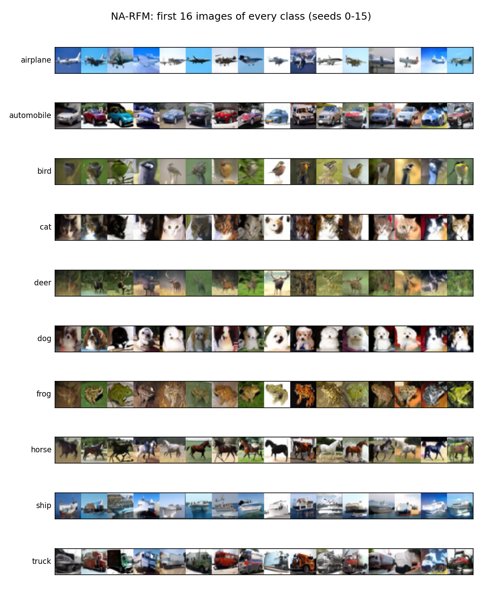
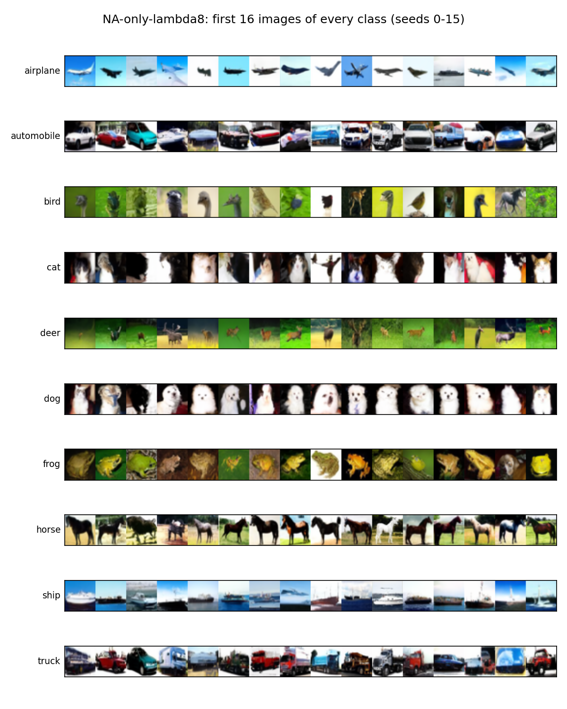
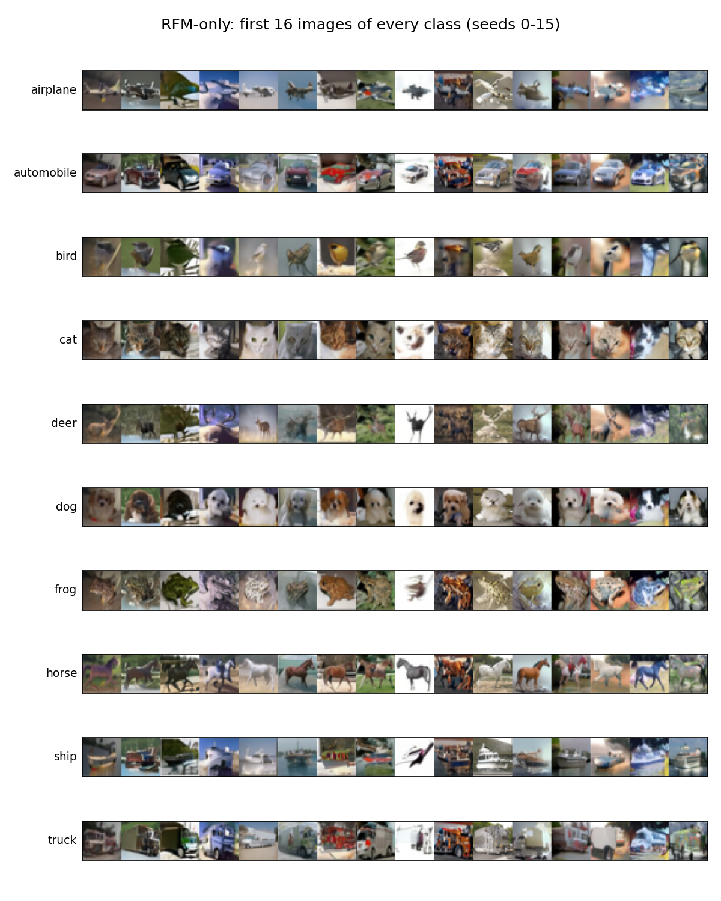
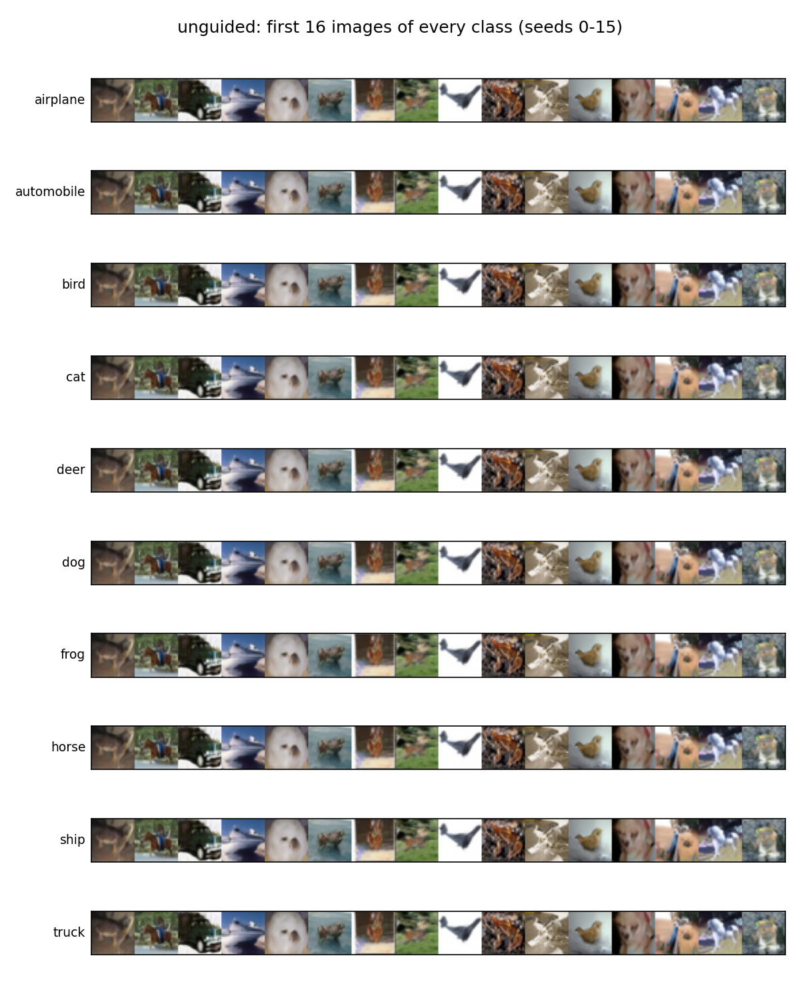

# Replicating NA-RFM on CIFAR-10 (Table 2)

Po-Hua Chen · DSC 180A D32 · Replication of Table 2 in Wang, Belkin and Wang (2026),
[General and Efficient Steering of Diffusion Models](https://arxiv.org/abs/2602.11395).

## Environment Setup

I ran all the experiments on my own computer. It is a Windows computer with an RTX 4070 Ti SUPER GPU. All the code is in the notebook `narfm_cifar10_starter_windows (1).ipynb`.

Before running the notebook, you need to install Python 3.10 or above, PyTorch with CUDA support, and Git. The first cell of the notebook will install the other packages and download the code from the paper: na-rfm (commit `8e9619b`) and TFG (commit `f8d17f3`). It will also fix two problems with newer package versions: the name of the CIFAR-10 dataset and a SciPy import. The next cells will download the pretrained CIFAR-10 diffusion model and CIFAR-10 images.

The original starter notebook was written for Colab, so I made some modifications to make it run on Windows. I used UTF-8 to read files and command output, used Windows' path separator in `PYTHONPATH`, and skipped the smoke test in section 3, which requires bash.

To get the following results, just run the notebook from beginning to end. Section 5 contains RFM directions and AUC (5a), five experimental settings (5b), accuracy, FID and time calculations (5c), as well as the results table, PCA figure, and generated image grids (5d).

## Results

**PCA (cat and ship):** This figure shows the mean images and the first eight PCA directions for cats and ships. The mean image of ships is blue at the top and grayer at the bottom, while the mean image of cats is more uniform in color.

**RFM AUC per class:** airplane 0.943, automobile 0.965, bird 0.879, cat 0.863, deer 0.893, dog 0.884, frog 0.950, horse 0.897, ship 0.950, truck 0.942. The cat class has the lowest AUC, while the automobile class has the highest.

**Table 2:**

| Setting | Accuracy (ours) | Accuracy (paper) | FID (ours, 256/class) | FID (paper, 2,048/class) | Time (ours, s/image) | Time (paper, s/16 images) |
|---|---|---|---|---|---|---|
| Unguided | 10.0% | – | 157.9 | – | 0.135 | – |
| Noise alignment, λ = 3 | 61.8% | 62% | 91.0 | 99 | 0.080 | 5.8 |
| Noise alignment, λ = 8 | 79.8% | 80% | 111.0 | 120 | 0.080 | 5.8 |
| RFM only | 96.2% | 94.8% | 94.6 | 40.3 | 0.159 | 6.8 |
| NA-RFM | 96.6% | 96.6% | 94.2 | 41.4 | 0.136 | 6.2 |

**Grids (first 16 images of every class):**

NA-RFM: almost every image is the requested class.

Noise alignment, λ = 3: many wrong classes.

Noise alignment, λ = 8: more correct, but more saturated and alike.

RFM only: correct, but duller.

Unguided: mixed classes.

## What matches and what does not

### What matches

The accuracy is very close to the paper's, with a maximum difference of only 1.4 percentage points. NA-RFM is 96.6%, the same as the paper; noise alignment gives 61.8% and 79.8%, and the paper gives 62% and 80%.

The noise alignment trade-off also matches: the larger λ, the higher the accuracy, but FID gets worse. For example, when λ = 8, the images are more saturated and look more alike. The order of the times also matches the paper.

### What does not match

The FID of RFM only and NA-RFM is about twice the paper's, probably because I only used 256 images per class, while the paper used 2,048. When fewer images are used, FID is usually higher.

My noise alignment FID is lower than the paper's, but I'm not sure why yet. I also can't directly compare the times because I used a different GPU and batch size.

