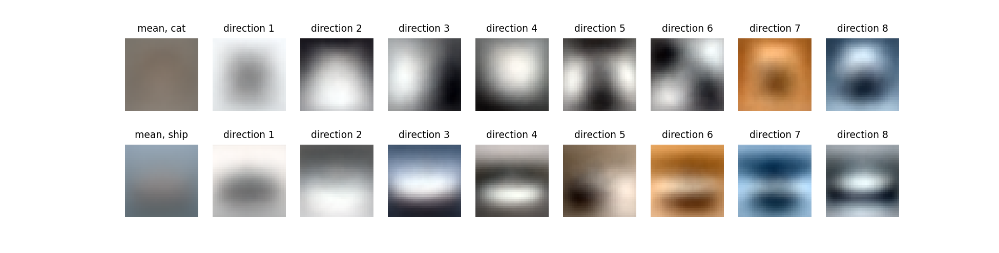
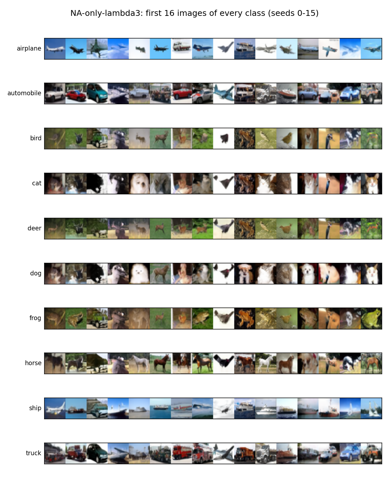

# Replicating NA-RFM on CIFAR-10 (Table 2)

Po-Hua Chen · DSC 180A D32 · Replication of Table 2 in Wang, Belkin and Wang (2026),
[General and Efficient Steering of Diffusion Models](https://arxiv.org/abs/2602.11395).

## Setup

- **Install:** Python 3.10+ with `torch` (CUDA), `torchvision`, `numpy`, `matplotlib` and `git`. The first cell
  installs the rest with pip.
- **Code:** the notebook clones [na-rfm](https://github.com/isotrivial/na-rfm) at commit `8e9619b` and
  [TFG](https://github.com/YWolfeee/Training-Free-Guidance) at commit `f8d17f3`, and makes two fixes: the CIFAR-10
  dataset name (`uoft-cs/cifar10`) and a SciPy import.
- **Model and data:** the notebook downloads OpenAI's improved DDPM U-Net for CIFAR-10 (checked by MD5) and
  CIFAR-10 from Hugging Face.
- **Windows:** I ran it on an RTX 4070 Ti SUPER, so I used UTF-8 for files and command output, `os.pathsep` in
  `PYTHONPATH`, and skipped the `bash` smoke test.

**Each figure and table:** run all cells of `narfm_cifar10_starter_windows (1).ipynb`. Section 5 makes
`rfm_auc.json` and the PCA figure (5a), the five settings (5b), `table2_replication.csv` (5c) and the grids (5d).

## Results

**PCA (cat and ship):** the ship mean shows sky above water; the cat mean is a flat blur, since cat photos vary more.

**RFM AUC per class:** airplane 0.943, automobile 0.965, bird 0.879, cat 0.863, deer 0.893, dog 0.884,
frog 0.950, horse 0.897, ship 0.950, truck 0.942. Animals are hardest to separate.

**Table 2:**

| Setting | Accuracy (ours) | Accuracy (paper) | FID (ours, 256/class) | FID (paper, 2,048/class) | Time (ours, s/image) | Time (paper, s/16 images) |
|---|---|---|---|---|---|---|
| Unguided | 10.0% | – | 157.9 | – | 0.135 | – |
| Noise alignment, λ = 3 | 61.8% | 62% | 91.0 | 99 | 0.080 | 5.8 |
| Noise alignment, λ = 8 | 79.8% | 80% | 111.0 | 120 | 0.080 | 5.8 |
| RFM only | 96.2% | 94.8% | 94.6 | 40.3 | 0.159 | 6.8 |
| NA-RFM | 96.6% | 96.6% | 94.2 | 41.4 | 0.136 | 6.2 |

**Grids (first 16 images of every class):**

NA-RFM: almost every image is the requested class.

Noise alignment, λ = 3: many wrong classes.

Noise alignment, λ = 8: more correct, but more saturated and alike.

RFM only: correct, but duller.

Unguided: mixed classes.

## What matches and what does not

### What matches

The accuracy is very close to the paper's, with a maximum difference of only 1.4 percentage points. NA-RFM is 96.6%, the same as the paper; noise alignment gives 61.8% and 79.8%, and the paper gives 62% and 80%.

The noise alignment trade-off also matches: the larger λ, the higher the accuracy, but FID gets worse. For example, when λ = 8, the images are more saturated and look more alike. The order of the times also matches the paper.

### What does not match

The FID of RFM only and NA-RFM is about twice the paper's, probably because I only used 256 images per class, while the paper used 2,048. When fewer images are used, FID is usually higher.

My noise alignment FID is lower than the paper's, but I'm not sure why yet. I also can't directly compare the times because I used a different GPU and batch size.

